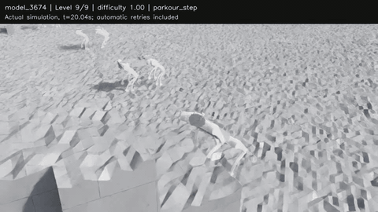

> **2026-10-23 현재:** Teacher 추가 학습의 이득을 평가한 뒤 `model_3674.pt`를 선택해 Student 학습을 시작했다. [실행 상태와 판단 근거](PHASE4_STATUS.md).

# RBQ_WMP — RBQ10 Isaac Lab Vision Parkour

공개 [Isaaclab_Parkour](https://github.com/CAI23sbP/Isaaclab_Parkour)의 PPO·Reward·Curriculum·Teacher/Student 구조를 재사용한 RBQ10 파쿠르 프로젝트입니다. 모델은 [Rainbow Robotics 공식 RBQ](https://github.com/RainbowRobotics/RBQ)를 사용합니다.

**2026-10-23:** Phase 1·2 완료. Phase 3 Teacher는 **3,675 업데이트**에서 디스크 부족으로 안전 중단한 뒤, 공간 확보 후 **2026-10-23 09:14 KST에 학습을 재개했습니다. 배포 snapshot은 3,675 업데이트 시점입니다.** 재개 가능한 실제 `model_3674.pt`를 포함합니다. Vision Student·실물 적용은 아직 완료하지 않았습니다. [진행 상황과 남은 단계](docs/STATUS.md).

## 마지막 단계 실제 평가

Curriculum은 0~9의 10단계입니다. `model_3674.pt`를 **level 9 / difficulty 1.0에 고정**하여 20개 환경 × 3회 = 60개 episode를 평가했습니다. 성공·실패 후에도 9단계를 유지하는 평가 옵션을 추가했고, 학습 기본값은 원본 curriculum입니다.

| 지형 | 완주 / 시험 | 낙상 | 시간 초과 |
| --- | --- | --- | --- |
| 평지 | 12 / 12 | 0 | 0 |
| Hurdle | 12 / 12 | 0 | 0 |
| Step·턱 | 10 / 12 | 1 | 1 |
| Gap·틈새 | 12 / 12 | 0 | 0 |
| 발판 코스 | 12 / 12 | 0 | 0 |

**[50초 전체 영상](artifacts/rbq10_teacher_3674_level9.mp4)** · [원시 JSON](evaluations/level9_model3674/results.json) · [CSV](evaluations/level9_model3674/results.csv) · [조건과 한계](docs/LEVEL9_EVALUATION.md)



명목 마찰·고정 seed·0.6 m/s 명령의 작은 시뮬레이션 시험입니다. 학습 중 완주율, 검증된 공중 점프 성공률, Vision Student 또는 실물 성능을 뜻하지 않습니다. 원본 roughness와 초기 관절 ±5% 변화는 유지합니다.

## 다른 PC에서 실행

검증 환경: Ubuntu 24.04, Python 3.11, **Isaac Sim 5.1 / Isaac Lab v2.3.2 / Torch 2.7.0+cu128 / torchvision 0.22**, RTX 5080 Laptop 16GB. RSL-RL 2.3.3은 프로젝트 전용 venv에 설치합니다. 먼저 호환되는 Isaac Lab 런타임을 준비하세요. Isaac Sim 설치물은 이 저장소에 포함하지 않습니다. 6,144환경 학습 시 GPU 약 10GB를 사용했으며 디스크 여유는 20GB 이상을 권장합니다.

```bash
git clone https://github.com/kimminjae-robot/RBQ_WMP.git
cd RBQ_WMP

# 실제 Isaac Lab용 Python 경로로 바꾸세요. 기존 환경은 수정하지 않습니다.
python3 tools/setup_env.py --isaac-python /path/to/isaaclab/venv/bin/python
```

설치 도구는 원본 commit `d6766d8883cffe427f2d4c087717d4eca1f23d8c`를 프로젝트 `upstream/Isaaclab_Parkour`에 받고 `patches/current_upstream.patch`를 적용합니다. 다른 revision/수정이나 기존 venv는 덮어쓰지 않습니다. 생성된 `.venv`는 지정한 Isaac 런타임에 의존합니다. [다른 PC 사용 안내](docs/PORTABILITY.md).

평가만 실행:

```bash
./run.sh evaluate-teacher \
  --checkpoint checkpoints/rbq10_teacher/model_3674.pt \
  --level 9 --num_envs 20 --episodes 3 --seed 42 --headless \
  --output evaluations/local_level9/results.json

# 영상을 저장하려면 위 명령에 추가:
# --video artifacts/local_level9.mp4
```

중단한 Teacher를 **총 5,000회까지** 이어 학습:

```bash
# 모델 hash와 RBQ10 계약 확인 후 원본 runner의 resume 경로로 복사
./run.sh import-teacher

# 3,675 + 1,325 = 5,000회. --iterations는 추가 업데이트 수입니다.
./run.sh teacher-job start --num_envs 6144 --iterations 1325 --seed 1 \
  --resume "$PWD/logs/rsl_rl/rbq10_extreme_parkour/imported_teacher_3674/model_3674.pt"

./run.sh teacher-job status
# 필요할 때: 현재 PPO update 완료 후 저장·중단
./run.sh teacher-job stop
```

총 50,000회까지 이어가려면 `--iterations 46325`를 사용하세요. 작은 GPU에서는 `--num_envs 1024` 또는 `2048`로 줄일 수 있지만 rollout batch 크기가 달라집니다. 같은 학습 설정을 유지하려면 6,144환경을 사용하세요. Parameter·optimizer·RMA counter를 복원하며 simulator episode와 terrain curriculum 분포는 재초기화됩니다.

```bash
.venv/bin/python -m tensorboard.main \
  --logdir logs/rsl_rl/rbq10_extreme_parkour --host 127.0.0.1 --port 6006
```

`Train/mean_reward`, `Train/mean_episode_length`, `Parkour/<지형>/course_success_rate`, `fall_rate`, `terrain_level`을 확인합니다. 지형별 최근 최대 1,000개 완전한 episode의 학습 통계이며 별도 고정 단계 평가와 구분하세요.

## 구성

- `rbq10_parkour/`: 공식 RBQ10 모델·관절/센서 계약, 원본 환경·runner 상속, 측정·평가 도구.
- `assets/rbq10/manifest.json`: 공식 모델 고정 commit, 출처·hash. 생성 USD는 각 PC에서 변환합니다.
- `checkpoints/rbq10_teacher/`: 실제 Teacher와 auxiliary optimizer/RMA counter, hash·원래 설정 snapshot.
- `patches/current_upstream.patch`: 원본 대비 전체 변경. PPO 손실·network·reward·terrain 생성식은 재작성하지 않았습니다.
- `tools/setup_env.py`: 기존 Isaac 런타임을 읽는 별도 venv 설치.
- `tools/teacher_job.py`: 중복 실행 방지, 안전 중단·재개, 디스크 2GiB 미만 자동 중단.

Go2/RBQ10 환경과 모델 계약은 분리돼 있습니다. 중간 검증은 headless, GUI는 각 Phase 마지막에만 사용합니다. 16GB GPU에서 대규모 학습과 RTX 녹화를 동시에 실행하지 마세요.

Phase 1 Go2 가중치는 새 설치 시 `--download-go2`로 별도 받을 수 있습니다. 출처와 hash는 `checkpoints/manifest.json`, 기존 venv에서의 다운로드 방법은 [PORTABILITY.md](docs/PORTABILITY.md)에 있습니다.

원본 고지: [LICENSE](LICENSE), [THIRD_PARTY.md](THIRD_PARTY.md). `docs/history/`는 과거 PC의 검증 기록이며 현재 상태는 [docs/STATUS.md](docs/STATUS.md)가 기준입니다.

MuJoCo 사전 준비: [실행 방법과 실제 초기 실패 결과](docs/SIM2SIM.md), [실물 적용 전 관측값·센서·제어 차이](docs/DEPLOYMENT_GAPS.md).

MuJoCo 기본 경로는 이제 **Vision Student**다. `export-sim2sim --checkpoint STUDENT.pt`와 `sim2sim`을 사용한다. reference/측정 선속도 분리, 조이스틱 방향, 수동 terrain label, MuJoCo contact를 반영했다. RBQ10 Student 학습 전에는 실제 rollout을 수행할 수 없다. [현재 계약과 명령](docs/SIM2SIM.md).

카메라 장착 TF는 [제조사 공식 좌표](https://rainbowrobotics.github.io/RBQ/manual/hardware/coordinate-frames.html#front-and-rear-cameras-oak-d-pro-wide)의 전방 OAK-D Pro Wide **Depth** 프레임으로 보정했다. Isaac Student/MuJoCo 모두 `(0.388031,-0.037500,0.037764)m`, ROS quaternion `(0.5,-0.5,0.5,-0.5)`를 사용한다.
