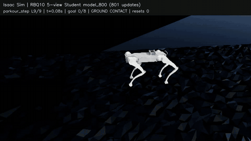
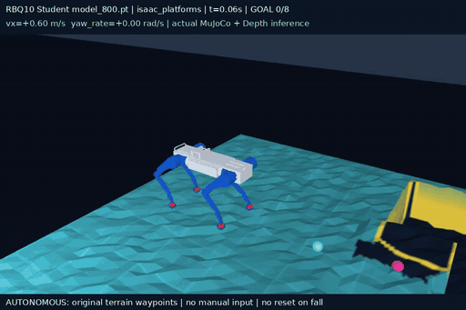

# RBQ_WMP — RBQ10 Vision Parkour

[Isaaclab_Parkour](https://github.com/CAI23sbP/Isaaclab_Parkour)의 PPO·Reward·Curriculum·Teacher/Student 증류를 재사용하고, [Rainbow Robotics 공식 RBQ10 모델](https://github.com/RainbowRobotics/RBQ)을 이식한 프로젝트입니다.

**2026-10-23 최신 검증: 5뷰 Student `model800` / 새 분기 801 update.** 전방 Depth 1개와 하향 D430 4개를 사용합니다. 현재 5뷰 학습만 2,000 update 목표로 계속 실행 중이며, 전방 전용 Student는 1,550 update에서 저장·중단했습니다.

## 최신 실제 시연

**Isaac Sim — 0.45m Step 오르내리기:** model800, level9, seed42, 속도 명령0.6m/s. 해당 episode는 **8.68초에 목표 8/8을 완주**했습니다. GIF는 자동 reset 직전까지의 구간이며 전체 영상·접촉/상태 기록도 제공합니다.



[전체 MP4](artifacts/student_depth5_model800_isaac_step_l9.mp4) · [프레임별 상태와 종료 판정](artifacts/student_depth5_model800_isaac_step_l9.json)

**MuJoCo — 중간 난이도 스테핑 스톤:** 같은 model800, difficulty0.5, seed42, 속도0.6m/s. 키보드 입력·낙상 후 reset 없이 **9.52초에 목표 8/8을 완주**했습니다. 높이별 지형 색과 노란 경계 표시를 적용한 실제 렌더입니다.



[전체 MP4](artifacts/student_depth5_model800_mujoco_platforms.mp4) · [주행 상태·결과](evaluations/multiview_sim2sim_model800/video_platforms.json)

두 영상은 동일 모델의 서로 다른 맵 시연입니다. 동일 지형에서 두 엔진의 물리를 짝 비교한 결과나 모든 조건의 성공률을 뜻하지 않습니다.

## 최신 MuJoCo 성능

model800을 고정해 **6종 × 중간 난이도 seed42/43/44 = 18회**, 추가 최고 난이도 Step·Gap 각1회를 실행했습니다. 모두 실제 Student의 CNN/fusion/GRU/actor로 추론하며 Teacher action으로 대체하지 않습니다.

| 지형 | 중간 난이도0.5 완주 / 실행 | 최고 난이도1.0 완주 / 실행 |
|---|---:|---:|
| 평지 | 3 / 3 | — |
| Hurdle | 3 / 3 | — |
| Step | 3 / 3 | 0 / 1 |
| Gap | 3 / 3 | 0 / 1 |
| Platforms / stepping stones | 3 / 3 | — |
| Mixed | 3 / 3 | — |
| **합계** | **18 / 18** | **0 / 2** |

이전 model400의 같은 중간 조건은15/18, Step0/3이었습니다. model800은 중간 조건에서 개선됐지만 최고 Step은 이전1/1에서 이번0/1이므로, 모든 난이도의 성능 향상이나 수렴으로 판단하지 않습니다. 작은 고정 개발 집합이며 held-out 평가·실물 검증은 남아 있습니다.

[최신 평가 조건·원시 결과·남은 차이](docs/MULTIVIEW_MODEL800_EVALUATION.md) · [이전 model400 카메라/전이 검사](docs/MULTIVIEW_SIM2SIM.md) · [현재 단계와 다음 작업](docs/STATUS.md)

## 내 PC에서 맵 실행

배포한 model800 TorchScript Export를 사용하므로 **MuJoCo 재생에는 Isaac Sim이 필요 없습니다.** Python3.11 환경과 고정된 원본 지형 소스를 준비하는 전체 명령은 [5뷰 빠른 시작](docs/DEPTH5_QUICKSTART.md)에 있습니다.

```bash
./run.sh sim2sim \
  --policy-dir evaluations/multiview_sim2sim_model800/export \
  --course isaac_platforms --difficulty .5 --terrain-seed 42 \
  --speed .6 --seconds 30 --autonomous --viewer --hold-seconds 60
```

| `--course` | 지형 |
|---|---|
| `isaac_flat` | 평지 |
| `isaac_hurdle` | 연속 장애물 |
| `isaac_step` | 턱·계단식 플랫폼 |
| `isaac_gap` | 틈새 |
| `isaac_platforms` | 스테핑 스톤 |
| `isaac_mixed` | 혼합 코스 |

- 난이도는 `--difficulty 0~1`, 배치는 `--terrain-seed`로 선택합니다.
- 자동 모드는 알려진 지도 목표점을 따라갑니다. 미지 환경의 비전 경로 계획 검증은 아닙니다.
- 수동 조작은 `--autonomous --viewer`를 `--keyboard`로 바꿉니다. GUI 클릭 후 W/S 속도, A/D 회전, Space 명령0, R reset, Q 종료입니다.
- 영상 저장은 `--video artifacts/my_run.mp4`, 결과 저장은 `--output outputs/my_run.json`입니다.
- `sim2sim-latest`, `demo_autonomous.sh`, `play_stones_medium.sh`는 이전 **전방 전용** 모델용입니다. 5뷰에는 위 `--policy-dir`을 사용합니다.

## 학습 상태 보관과 재개

| 보관본 | 용도 |
|---|---|
| `checkpoints/rbq10_teacher/model_3674.pt` | frozen Teacher/증류 기준 |
| `checkpoints/rbq10_student_front/` | 전방 Student 1,550 update 전체 보관본 |
| `checkpoints/rbq10_student_multiview/` | **5뷰 model700 / 701 update 전체 재개본**, 가중치·Adam·counter 보존 |
| `evaluations/multiview_sim2sim_model800/export/` | **최신 검증 model800의 MuJoCo 실행 모델** |
| `evaluations/multiview_sim2sim_model400/export/` | 이전 검증 model400 실행 모델 |

전체 재개본은 GitHub 파일 크기 제한을 피하도록 압축 조각으로 보관합니다. 조각·압축본·복원본 SHA-256을 확인해 무손실 복원하며, 다른 기존 파일을 덮어쓰지 않습니다.

```bash
python3 tools/restore_student_checkpoint.py --directory checkpoints/rbq10_student_multiview

# Isaac Lab/프로젝트 venv를 준비한 후: 701 + 1299 = 새 분기 2000 update
./run.sh multiview-student-job start \
  --checkpoint checkpoints/rbq10_student_multiview/model_700.pt \
  --iterations 1299 --num_envs 192 --seed 1
./run.sh multiview-student-job status
```

재개본 model700과 평가 모델800은 서로 다른 snapshot입니다. 재개 시 물리 episode·curriculum/RNG 분포는 재초기화됩니다. 원래 PC의 학습은 이번 배포 중에도 계속 실행합니다.

학습 환경은 Ubuntu24.04 / Python3.11 / Isaac Sim5.1 / Isaac Labv2.3.2(package0.54.2) / Torch2.7+cu128 / RSL-RL2.3.3 조합으로 검증했습니다. 기존 환경을 수정하지 않고 프로젝트 venv를 구성합니다.

```bash
git clone https://github.com/kimminjae-robot/RBQ_WMP.git
cd RBQ_WMP
python3 tools/setup_env.py --isaac-python /path/to/isaaclab/venv/bin/python
```

[다른 PC 학습 환경 설치](docs/PORTABILITY.md) · [공식 카메라/5뷰 구조](docs/MULTIVIEW_STUDENT.md) · [전방 모델 보관](docs/FRONT_STUDENT_ARCHIVE.md)

## 남은 작업

- 5뷰 목표2,000 update 완료 후 held-out 지형과 동일 조건 Teacher/Student 평가.
- 최고 난이도 Step·Gap 전이 안정화. 관절 속도 제한, 접촉 응답과 지형 모서리 차이 검증.
- 실제 전방 CameraInfo/FOV, 하향 센서별 intrinsics·동기화·노이즈·가림 검증.
- 조이스틱·측정 속도·contact 추정 연결, 연속 코스·낮은 천장 Crawl 및 실물 시험.

Phase1 원본 Go2 재현과 Phase2 RBQ10 이식은 완료했고, Teacher 학습은 저장·종료했습니다. 현재 Phase4의 5뷰 Student 학습과 Phase5의 시뮬레이션 검증을 진행 중입니다. 수직 벽 부착 등반은 범위에서 제외합니다.

[진행 단계](docs/STATUS.md) · [개선 로드맵](docs/PERFORMANCE_ROADMAP.md) · [후속 과제 #1](https://github.com/kimminjae-robot/RBQ_WMP/issues/1) · [과거 Teacher 평가](docs/LEVEL9_EVALUATION.md)

원본 commit은 `d6766d8883cffe427f2d4c087717d4eca1f23d8c`로 고정합니다. 원본 CNN을 5개 view에 공유하고 학습된 fusion을 추가해 원본 GRU/actor/증류를 재사용하며 PPO·Reward·Curriculum을 재작성하지 않았습니다. 원본 고지는 [LICENSE](LICENSE), [THIRD_PARTY.md](THIRD_PARTY.md)를 확인하세요.
