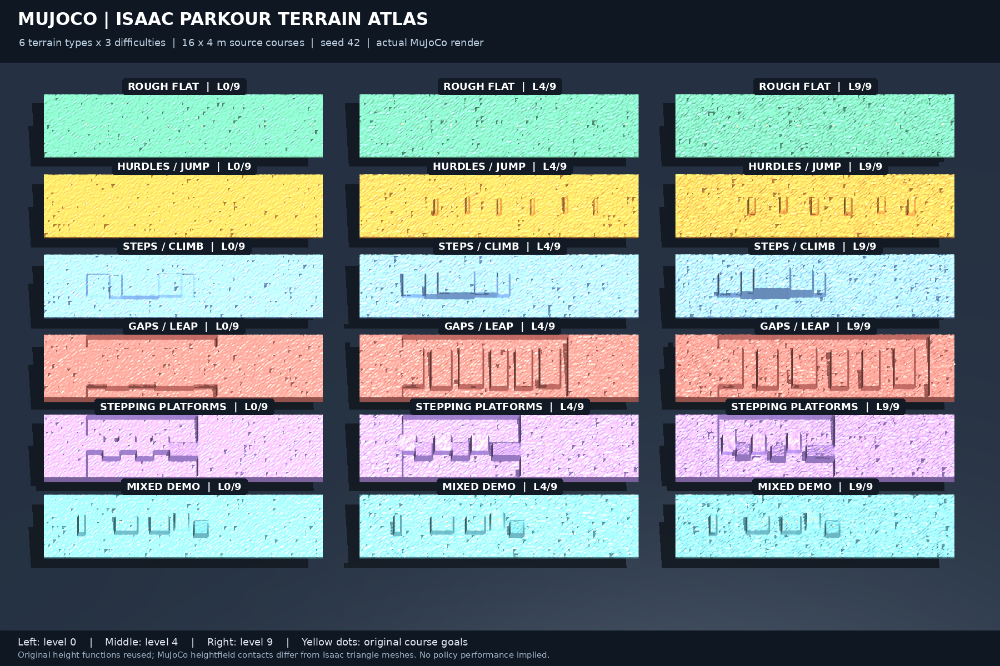

# MuJoCo 지형과 전체 조감도

2026-10-23 확인 시 기존에는 단순 평지/허들/턱 3종뿐이었다. 이제 **Isaac Lab 원본 raw height 생성 코드를 재사용한 6종**을 추가했다. 각 코스는 seed와 difficulty를 지정할 수 있다.



전체 조감도는 실제 MuJoCo 물리 지형을 렌더한 이미지다. 왼쪽부터 원본 curriculum level0/4/9(난이도 0/0.444/1), 위에서부터 다음 6종이며 총 18개 코스가 있다. 각 원본 코스는 16×4m, Student 원본 간격 0.1m를 사용한다. 샘플 끝점 사이 실제 높이장 범위는 15.9×3.9m다.

| 선택값 | 원본 지형 | 구성 |
| --- | --- | --- |
| isaac_flat | parkour_flat | 장애물을 비활성화한 rough flat |
| isaac_hurdle | parkour_hurdle | 점프용 반복 허들 |
| isaac_step | parkour_step | 누적 높이가 변하는 계단/턱 |
| isaac_gap | parkour_gap | 폭이 변하는 반복 gap, 원본 pit bottom 포함 |
| isaac_platforms | parkour | 기울어진 징검 플랫폼과 pit |
| isaac_mixed | parkour_demo | 허들·턱·틈새·플랫폼 혼합 코스 |

```bash
# 조감도 저장 + 전체 18코스 XML 생성. GUI 없이 실행.
./run.sh mujoco-map
# outputs/mujoco_terrain_map/atlas.xml, artifacts/mujoco_terrain_overview.png

# 전체 맵을 GUI에서 둘러볼 때만
./run.sh mujoco-map --viewer

# Student를 각 원본 코스에서 실행. 실제 저장된 Student export 필요.
./run.sh sim2sim --course isaac_gap --difficulty 1 --terrain-seed 42 --terrain-label parkour --seconds 20
./run.sh sim2sim --course isaac_platforms --difficulty 0.5 --terrain-label parkour --seconds 20
./run.sh sim2sim --course isaac_mixed --difficulty 0.5 --terrain-label parkour --seconds 20
```

기본 Student 실행 지형은 `isaac_flat`이다. `flat/hurdle/step`은 기존 단순 진단 지형으로 유지했다. 지형 label은 사용자가 지정하며 지형 선택값에서 자동으로 추론하지 않는다. flat 실험이면 `--terrain-label flat`을 지정한다. 18개 전체 atlas는 지형 관찰용이며 robot rollout은 한 코스를 선택한다. Student 학습 프로세스와 Isaac 맵은 변경하지 않았다.

## 원본 재사용 범위

`sim2sim/terrains.py`가 다음 원본 파일을 읽는다.

- `parkour_isaaclab/terrains/extreme_parkour/extreme_parkour_terrians.py`: 실제 높이 생성 함수, roughness, goal 생성.
- `extreme_parkour_terrains_cfg.py`, `config/parkour.py`, `parkour_terrain_generator_cfg.py`: 원본 설정·장애물 크기·난이도 수식.

Isaac를 실행하지 않기 위해 AST로 simulator import와 mesh decorator만 분리하고, configclass 대신 단순 설정 객체를 사용한다. 원본 함수 본문을 복사해 새 지형 알고리즘으로 재작성하지 않는다. Student의 horizontal_scale=0.1과 parkour 외 y_range=(-0.1,0.1) override도 맞춘다. 원본 파일 hash, 각 grid hash, seed, difficulty, height range, goal을 manifest에 기록한다.

## 물리 표현과 검증

MuJoCo는 각 원본 높이 배열을 **heightfield collision geometry**로 사용한다. [MuJoCo heightfield 문서](https://mujoco.readthedocs.io/en/3.3.5/XMLreference.html#asset-hfield)의 행/열·scale 규칙과 설치된 3.3.0의 elevation row flip을 고려했다. 단일 큰 mesh를 convex hull로 만드는 방식은 사용하지 않아 gap/pit를 평면으로 채우지 않는다. 일반 z=0 바닥도 제거하고 −2.5m에 catch floor만 둔다.

18개 코스에서 1,224개 grid 지점을 실제 `mj_ray`로 검사했다. 원본 height와 MuJoCo collision height의 최대 오차는 약 3.3e-8m다. 모든 원본 robot+course scene이 compile되고 seed 재생성이 동일하며 짧은 physics 실행의 상태가 유한함을 확인했다. `physics_checks.json`의 초기 home-PD pose/tilt는 진단 결과이며 코스 완주 시험이 아니다. 초기 Student checkpoint를 사용한 gap/mixed의 0.2초 입력 연결도 확인했으며 성공률 평가로 취급하지 않는다.

**표본 높이는 보존하지만 원본 Isaac 삼각형 mesh의 slope-threshold 모서리 보정과 simplify triangulation까지 동일하지는 않다.** 특히 가파른 모서리는 0.1m grid의 삼각 경사면으로 표현된다. 같은 높이에서 MuJoCo 접촉과 PhysX 접촉이 같다고 가정할 수 없다. 원본 지형 목표는 제공하지만 자동 navigation/동일 curriculum reset/완주 scoring은 별도이며, 현재 Student 조이스틱 실행에서 정답 waypoint를 주입하지 않는다. Crawl 천장 구조는 원본 6종 heightfield에 없으며 추가하지 않았다.

증거: `evaluations/mujoco_terrain_map/{manifest.json,physics_checks.json}`.
