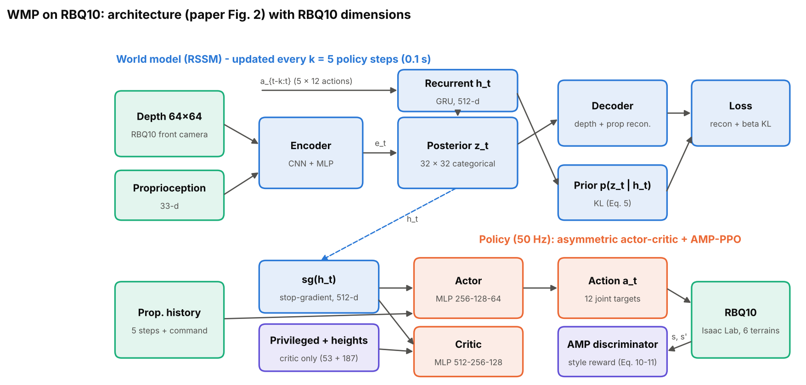
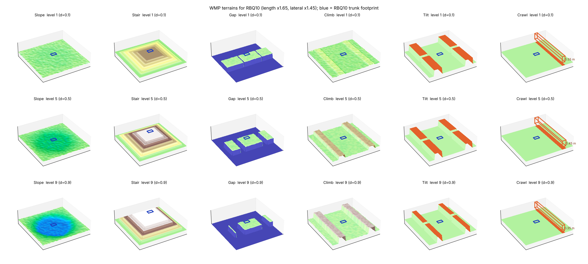
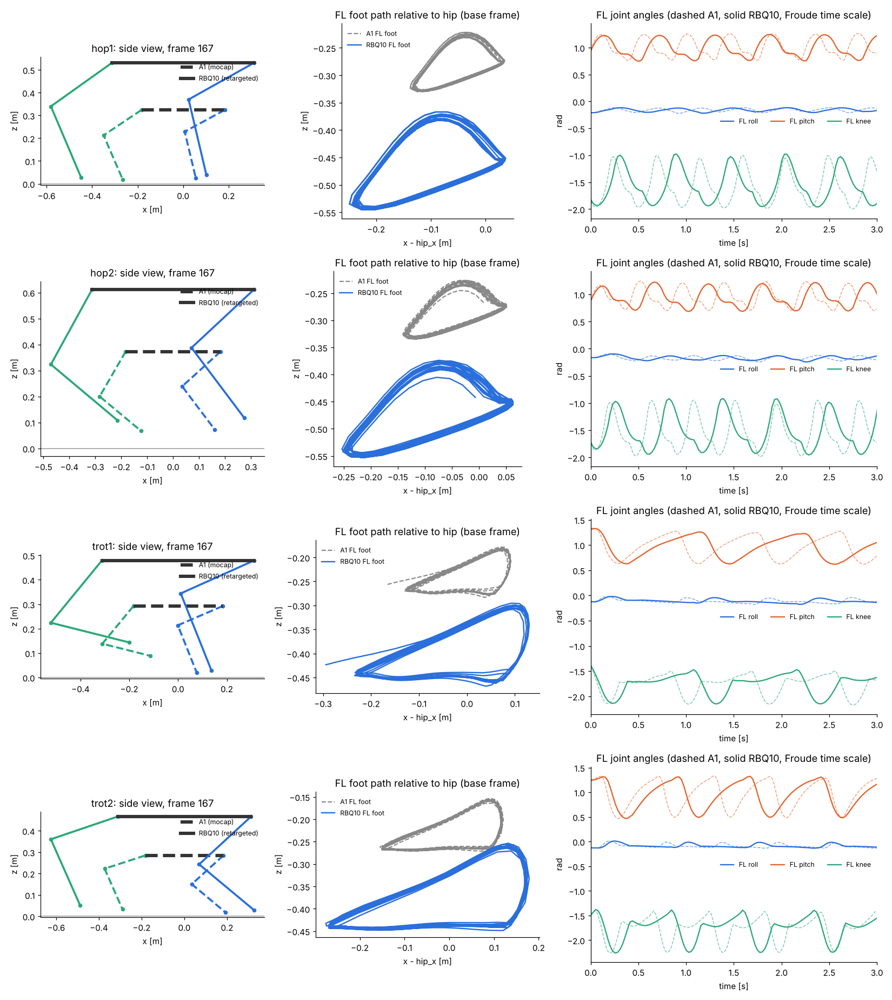

# WMP (World Model-based Perception) — RBQ10 구현

논문: Hang Lai et al., *World Model-based Perception for Visual Legged Locomotion*, arXiv [2409.16784](https://arxiv.org/abs/2409.16784)
참조 코드: [bytedance/WMP](https://github.com/bytedance/WMP) (Apache-2.0, 하위 구성요소 BSD-3 / MIT — `licenses/wmp/`)

기존 Teacher/Student 증류(`rbq10_parkour/`)와 **완전히 분리된** 패키지 `rbq10_wmp/`로 구현했습니다. 기존 태스크·체크포인트·스크립트는 바뀌지 않습니다.



## 1. 구성

| 논문 요소 | 파일 | 원본 대비 |
|---|---|---|
| RSSM 월드모델 (Eq. 1–5) | `rbq10_wmp/dreamer/{networks,models,tools}.py` | 원본 그대로 이식. CPU 실행을 위한 device 기본값·`autocast`·`GradScaler` 수정만 |
| 월드모델 하이퍼파라미터 | `rbq10_wmp/dreamer/config.py` | 원본 `configs.yaml` 값 (h 512, z 32×32, batch 16×64, k=5) |
| Actor-Critic (Eq. 6–7), 속도 추정기 | `rbq10_wmp/rl/actor_critic_wmp.py` | 원본 그대로 |
| AMP-PPO, 판별기 (Eq. 10–11) | `rbq10_wmp/rl/{amp_ppo,amp_discriminator,replay_buffer,rollout_storage,utils}.py` | 원본 그대로 |
| AMP 참조 모션 로더 | `rbq10_wmp/rl/motion_loader.py` | `pybullet`/`np.int` 의존 제거한 재구현 (사용 경로 동일) |
| WMP 러너 (월드모델+정책 동시 학습) | `rbq10_wmp/runner.py` | 업데이트 순서 동일. 아래 §3 참고 |
| 6종 지형 + 커리큘럼 | `rbq10_wmp/env/terrain.py` | 원본 지형 생성 로직, RBQ10 크기로 스케일 |
| 관측·보상·종료·이벤트 | `rbq10_wmp/env/mdp.py`, `config.py`, `env.py` | legged_gym → Isaac Lab manager 항목으로 이식 |
| legged_gym 인터페이스 어댑터 | `rbq10_wmp/env_api.py` | Isaac Lab env를 원본 러너가 기대하는 API로 노출 |
| 배포용 추론 루프 | `rbq10_wmp/inference.py` | 원본 `play.py` 로직 |
| A1 → RBQ10 모션 리타깃 | `rbq10_wmp/retarget/a1_to_rbq10.py`, `tools/retarget_a1_mocap.py` | 신규 |

## 2. 실행

```bash
# Isaac Lab 학습 (원본: 4096 env, 20000 iteration)
./run.sh train-rbq10-wmp --num_envs 4096 --max_iterations 20000
./run.sh train-rbq10-wmp --smoke                     # 64 env 빠른 확인
# 재생 (+ 월드모델 depth 복원 저장)
./run.sh play-rbq10-wmp --checkpoint logs/wmp/<run>/model_20000.pt --save_depth depth.npz
# 그림
python3 tools/plot_wmp.py curves --log logs/wmp/<run>/progress.jsonl --out docs/wmp/training.png
python3 tools/plot_wmp.py depth --npz depth.npz --out docs/wmp/wm_depth.png
# 시뮬레이터 없이 CPU 검증
python3 -m unittest tests.test_wmp_cpu
./run.sh wmp-mock --iterations 150
```

로그는 TensorBoard와 `progress.jsonl`(그림용) 두 곳에 남습니다. 체크포인트에는 정책, 월드모델, AMP 판별기·정규화기, 옵티마이저와 `wmp_contract`(관측 차원·관절 순서·카메라·스케일)가 저장되며, contract가 다르면 로드를 거부합니다.

## 3. RBQ10 적용 시 바뀐 점

A1(다리 0.2 m + 0.2 m, 12 kg) 기준 값을 RBQ10(0.33 m + 0.33 m, 40.7 kg)에 맞췄습니다. 원칙은 **Froude 동역학 상사**(길이 ×S, 시간 ×√S, 선속도 ×√S, 각속도 ×1/√S, S = 1.65)이고 값은 모두 `rbq10_wmp/scaling.py` 한 곳에 있습니다. `S = 1`이면 원본 A1 값으로 돌아갑니다.

| 항목 | 원본 (A1) | RBQ10 |
|---|---|---|
| 지형 길이·높이 / 틸트 폭 | 1× | ×1.65 / ×1.46 (좌우 발 간격 비) |
| 명령 전진 속도 | 0 – 0.8 m/s | 0 – 1.03 m/s |
| 명령 각속도 | ±1.0 rad/s | ±0.78 rad/s |
| 추종 보상 σ (선/각) | 0.15 / 0.15 | 0.248 / 0.091 |
| Eq. 9 속도 clip | 0.1 m/s | 0.128 m/s |
| 발 체공 목표 | 0.5 s | 0.64 s |
| 속도 위반 종료 | 1.5 m/s | 1.93 m/s |
| 높이맵 (critic) | 1.6×1.0 m, 0.1 m 간격, 187점 | 2.64×1.65 m, 0.165 m 간격, 187점 |
| Depth far clip | 2 m | 3.3 m |
| 추가 몸통 질량 | 0 – 3 kg | 0 – 9.8 kg (질량비) |
| PD 게인 | kp 40 / kd 1 | 제조사 값 kp 123.4/123.4/127.8, kd 2.5 |
| 기본 관절각 | A1 | 제조사 `info.json` |
| 카메라 | A1 전방, 수평 FOV 58°, 64×64 | 제조사 전방 OAK-D TF 위치, FOV 58°, 64×64 (논문 값 유지) |
| AMP 참조 모션 | A1 mocap 4개 | 같은 4개를 RBQ10로 리타깃 (`datasets/rbq10_mocap`) |
| 최소 action std | 0.05/0.02/0.05 × 관절범위 | 동일. 단 RBQ10 pitch 관절 범위가 ±2π라 범위를 A1 thigh 범위(5.24 rad)로 제한 |

그 밖의 구현 차이:

- **모든 env에 Depth 카메라**: 원본은 4096개 중 1024개 env만 카메라를 달고 나머지는 높이맵→Depth 예측기로 채웠습니다. Isaac Lab ray-cast 카메라는 가벼워 전 env에 달았고, 월드모델 데이터셋은 원본처럼 1024개 env에서만 모읍니다(`wm_dataset_envs`). Depth 예측기는 필요 없어 빠졌습니다.
- **모터 출력 랜덤화**(원본: 매 substep 토크 ×U(0.8, 1.2))는 implicit PD 액추에이터에서 쓸 수 없어 빠졌습니다. PD 게인 랜덤화(리셋마다 ×U(0.8, 1.2))는 그대로입니다.
- 월드모델 데이터셋 이미지는 메모리 절약을 위해 float16으로 저장합니다.
- 보상 가중치는 원본 값 그대로입니다. RBQ10은 토크 크기가 커서 `torques`(−1e-4) 항의 비중이 A1보다 커질 수 있으니 첫 학습 곡선에서 확인이 필요합니다.

## 4. 검증 상태

| 검증 | 결과 |
|---|---|
| 리타깃 IK 왕복 오차 / A1 FK 재현 오차 / 관절 한계 위반 | 2.2e-16 m / 평균 1.9e-8 m / 0 |
| CPU 단위 테스트 (`tests/test_wmp_cpu.py`) | 6/6 통과 — IK, 지형 배치, 187점 높이맵, 모의 env API, 학습→저장→로드→추론 |
| CPU 모의 env 전체 루프 150 iteration | `docs/wmp/mock_training.png`, `docs/wmp/mock_wm_depth.png` |
| Isaac Lab 실제 학습 | **미실행** — 이 작업 환경에는 GPU·Isaac Sim이 없습니다. PC에서 `--smoke`부터 실행해 주세요 |

모의 env(`rbq10_wmp/mock_env.py`)는 물리 모델이 아니라, 원본과 동일한 텐서 인터페이스와 "Depth로만 보이는 장애물" 과제를 가진 검증용 장난감입니다. 여기서의 수치는 코드 경로가 맞게 연결되었는지만 보여줍니다.



